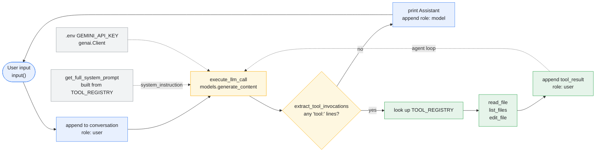

# Agent flow

How a turn moves through `coding_agent.py`, from user input to final answer.

**Outer loop** — one pass per user message: read input, append it, run the inner
loop until the model answers without calling a tool.

**Inner loop** — the dashed `tool_result` edge back into `execute_llm_call`. The
model keeps calling tools, each result fed back as a `role: user` turn, until a
response contains no `tool:` line. That loop has no iteration cap.

**Not shown, because the code does not do it:** the model's own tool-call turn is
never appended to `conversation` before the tool result is. The model therefore
does not see the request it just made.
